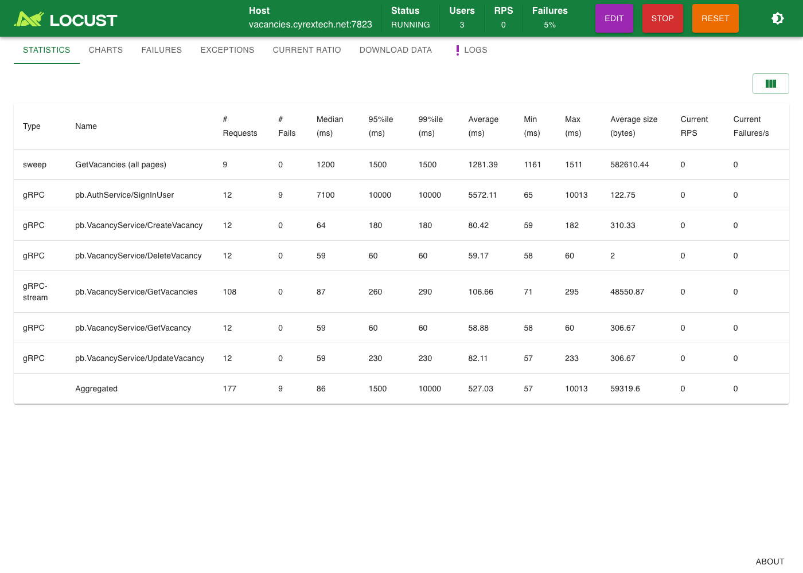
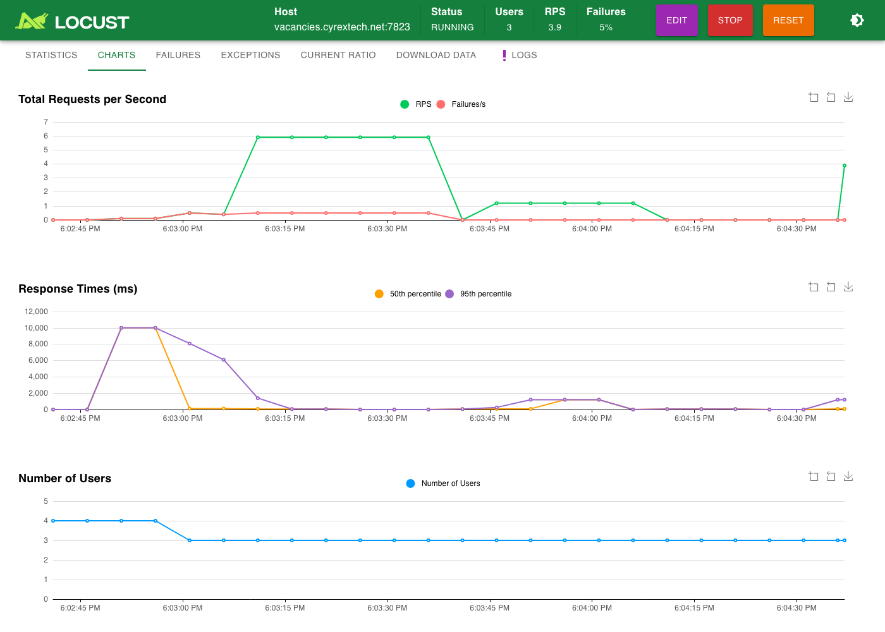
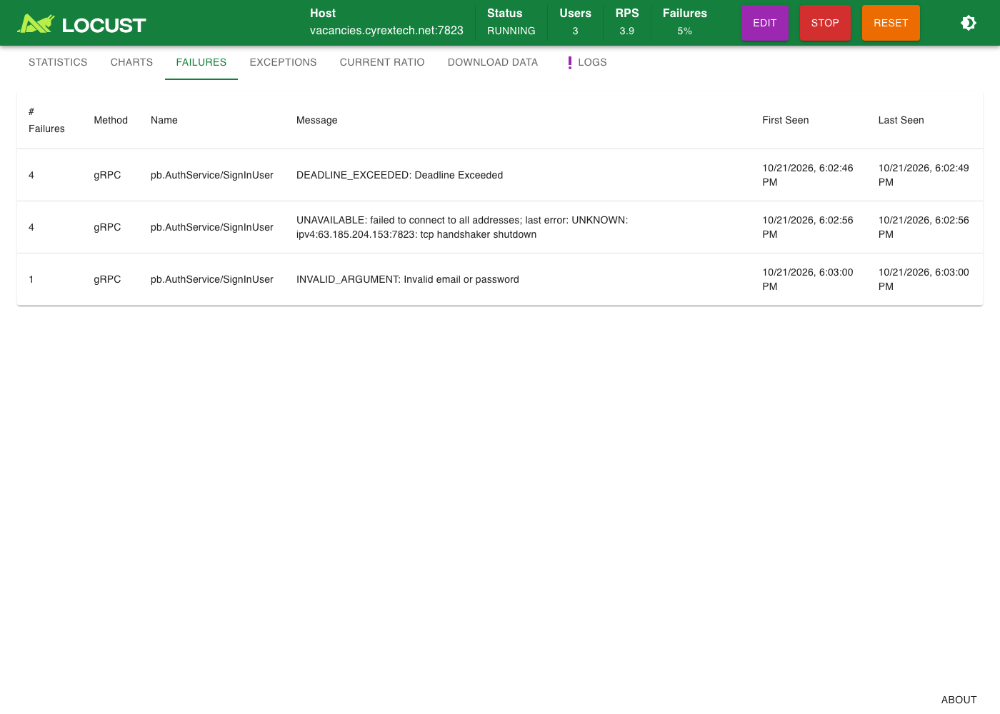

# vacancy-loadtest

A [Locust](https://docs.locust.io/en/stable/) load test for the gRPC **vacancy service** at
`vacancies.cyrextech.net:7823`, written for the *Python Dev – Practical Test*.

Every simulated user signs in with one of three pre-created accounts, then every **30 seconds**
creates a vacancy with pseudo-random data, updates some of its fields, fetches it and deletes it,
while a background job fetches the list of **all** vacancies every **45 seconds**. Every gRPC call,
unary or streaming, is timed and reported to Locust together with any error the server returns.

```text
locustfile.py ──▶ VacancyUser                      (src/vacancy_loadtest/users.py)
                   │  on_start   SignInUser with the next account (round-robin) ──▶ access token
                   │  @task      every 30 s: CreateVacancy ▶ UpdateVacancy ▶ GetVacancy ▶ DeleteVacancy
                   │  greenlet   every 45 s: GetVacancies page 1..n  (server-streaming, all pages)
                   └─ GrpcUser   one gRPC channel + LocustInterceptor ──▶ environment.events.request
                                                      (src/vacancy_loadtest/grpc_user.py)
```

The repository also contains an in-memory fake of the server, a test suite, a CI workflow and
Docker files. They are there so that everything can be verified offline, by anyone, without the
three accounts; the load test itself is the two modules above.

## Task checklist

| Task requirement | Where it is implemented |
|---|---|
| Create 3 users with BloomRPC/Evans, verify their e-mails, store the credentials | [Creating the accounts](#creating-the-accounts-pre-requirements): Evans session + `scripts/create_users.py`, stored in `credentials.json` |
| Every Locust user logs in with one of those credentials | `VacancyUser.on_start` → `sign_in()`; accounts are handed out round-robin by `credentials.CredentialPool` |
| Every 30 s: create a vacancy with pseudo-random data, update one or more fields, fetch it, delete it | `VacancyUser.vacancy_lifecycle` (`@task`, `constant_pacing(30)`), data from `data.VacancyFactory` |
| In the background, fetch the list of all vacancies every 45 s | `VacancyUser._sweep_forever` greenlet → `fetch_all_vacancies()` walks the paginated `GetVacancies` stream |
| Report response times of the gRPC requests in Locust | `grpc_user.LocustInterceptor` fires `events.request` for every unary and streaming RPC; each sweep is also reported as one row |
| Report any errors returned by the gRPC server | failed RPCs are reported as `CODE: details` (e.g. `NOT_FOUND: no vacancy with that Id exists`) and show up in Locust's failure table, CSV and HTML report |
| Submit as a zip or a GitHub link | `make dist` builds `vacancy-loadtest.zip` from the tracked files |

## Quick start

Requirements: Python ≥ 3.11 and [uv](https://docs.astral.sh/uv/) (`brew install uv` or
`pipx install uv`).

```bash
make install                       # uv sync: virtualenv + dependencies (+ dev tools)
make test                          # pytest against the bundled in-memory fake server, no network
# one-off: create the three accounts, see "Creating the accounts" below
make run                           # Locust web UI on http://localhost:8089 (start the test there)
make headless USERS=3 RATE=1 TIME=5m   # headless run, CSV + HTML report in reports/latest/
```

Without uv, in a virtualenv of your own:

```bash
pip install -r requirements.txt -r requirements-dev.txt -e .
make RUN= test                     # RUN= drops the `uv run` prefix; same for lint, smoke, run, …
locust                             # or call Locust directly
```

Without an account you can still watch the whole flow against the fake server:

```bash
make fake-server                                           # terminal 1, listens on :50051
uv run locust --host 127.0.0.1:50051 --credentials-file credentials.example.json   # terminal 2
```

## Creating the accounts (pre-requirements)

The task asks for this to be done with BloomRPC or Evans. BloomRPC was archived in January 2023,
so this uses [Evans](https://github.com/ktr0731/evans) (`brew install evans`). The server exposes
gRPC reflection, so no proto files need to be passed (`-r`); `--path proto --proto
auth_service.proto` works too.

The verification codes arrive **by e-mail**, so the accounts need real mailboxes. Gmail's
`+alias` addressing is convenient: `you+cyrex1@gmail.com`, `you+cyrex2@gmail.com`,
`you+cyrex3@gmail.com` all land in one inbox.

```bash
$ evans --host vacancies.cyrextech.net --port 7823 -r cli list
grpc.reflection.v1alpha.ServerReflection
pb.AuthService
pb.UserService
pb.VacancyService

# 1. sign up (×3)
$ echo '{"name": "Load Tester 1", "email": "you+cyrex1@gmail.com",
         "password": "<password>", "passwordConfirm": "<password>"}' \
    | evans --host vacancies.cyrextech.net --port 7823 -r cli call pb.AuthService.SignUpUser
{
  "message": "We sent an email with a verification code to you+cyrex1@gmail.com",
  "status": "success"
}

# 2. verify (×3), the e-mail contains a link that ends in /verifyemail/<code>
$ echo '{"verificationCode": "<code>"}' \
    | evans --host vacancies.cyrextech.net --port 7823 -r cli call pb.AuthService.VerifyEmail
{
  "message": "Email verified successfully",
  "status": "success"
}

# 3. check that the account can sign in (×3)
$ echo '{"email": "you+cyrex1@gmail.com", "password": "<password>"}' \
    | evans --host vacancies.cyrextech.net --port 7823 -r cli call pb.AuthService.SignInUser
{
  "accessToken": "eyJhbGciOiJSUzI1NiIsInR5cCI6IkpXVCJ9…",
  "refreshToken": "eyJhbGciOiJSUzI1NiIsInR5cCI6IkpXVCJ9…",
  "status": "success"
}
```

(`evans -r repl --host vacancies.cyrextech.net --port 7823` gives the same calls interactively.)

The credentials are stored in **`credentials.json`** (git-ignored, mode 0600), in the shape of
[`credentials.example.json`](credentials.example.json):

```json
[
  { "email": "you+cyrex1@gmail.com", "password": "…" },
  { "email": "you+cyrex2@gmail.com", "password": "…" },
  { "email": "you+cyrex3@gmail.com", "password": "…" }
]
```

The same three calls are automated in `scripts/create_users.py`, which asks for the codes as the
e-mails arrive and writes the file. It is idempotent: an account that already exists
(`ALREADY_EXISTS`) or is already verified is simply checked with `SignInUser` again. (Passwords
cannot be recovered from the server: if the file is lost, create new accounts.)

```bash
uv run python scripts/create_users.py --email 'you+cyrex{n}@gmail.com' --count 3
uv run python scripts/create_users.py --skip-signup --skip-verify   # later: just check sign-in
```

## Running the load test

Locust's own options apply as usual (`-u/-r/-t`, `--host`, `--csv`, `--html`, `--stop-timeout`,
`--master/--worker`, `--processes`, `--config`, …). The test adds the options below; each can
also be given as an environment variable and all but the last show up under *Custom parameters*
in the web UI. The defaults are the task's numbers.

| Option | Env var | Default | Meaning |
|---|---|---|---|
| `--credentials-file` | `LOADTEST_CREDENTIALS_FILE` | `credentials.json` | accounts created in the pre-requirements |
| `--crud-interval` | `LOADTEST_CRUD_INTERVAL` | `30` | seconds between two create→update→get→delete cycles of one user |
| `--list-interval` | `LOADTEST_LIST_INTERVAL` | `45` | seconds between two background "all vacancies" sweeps of one user |
| `--list-page-limit` | `LOADTEST_LIST_PAGE_LIMIT` | `500` | `GetVacanciesRequest.limit` per page while sweeping |
| `--list-max-pages` | `LOADTEST_LIST_MAX_PAGES` | `100` | safety cap on pages per sweep |
| `--rpc-timeout` | `LOADTEST_RPC_TIMEOUT` | `10` | deadline of every RPC in seconds (`DEADLINE_EXCEEDED` when hit) |
| `--token-ttl` | `LOADTEST_TOKEN_TTL` | `840` | sign in again this many seconds after the last sign-in (the server's tokens last 15 min); `0` = only after `UNAUTHENTICATED` |
| `--seed` | `LOADTEST_SEED` | – | seed for the pseudo-random vacancy content |
| `--no-relogin` | – | off | never sign in again (neither before the token expires nor after `UNAUTHENTICATED`) |

The target is Locust's `--host` (or `LOCUST_HOST`); without it the class default
`vacancies.cyrextech.net:7823` is used, which `LOADTEST_HOST` overrides (used by docker-compose).

```bash
# web UI
uv run locust                                   # then http://localhost:8089, set users + spawn rate

# headless, 3 users ramped at 1/s for 10 minutes, CSV + HTML report
uv run locust --headless -u 3 -r 1 -t 10m --csv reports/latest/run --html reports/latest/run.html

# let cycles that are in flight finish (and delete their vacancy) when the run stops
uv run locust --headless -u 3 -r 1 -t 10m --stop-timeout 30

# shorter intervals for a quick look (the task's 30 s / 45 s are the defaults)
uv run locust --headless -u 3 -r 3 -t 1m --crud-interval 5 --list-interval 10

# distributed: one process per CPU core on this machine, or an explicit master + workers
uv run locust --headless -u 30 -r 3 -t 10m --processes -1
uv run locust --master --expect-workers 2      # + `uv run locust --worker --master-host …` ×2

# Docker (image contains everything; mount the credentials)
docker build -f docker/Dockerfile -t vacancy-loadtest .
docker run --rm -p 8089:8089 -v "$PWD/credentials.json:/run/credentials.json:ro" \
    vacancy-loadtest --credentials-file /run/credentials.json
cd docker && docker compose up --build --scale worker=2        # master + 2 workers, UI on :8089
```

Every Locust worker reads the credentials file itself and hands the accounts out round-robin to
the users it spawns, starting at its own worker index, so three accounts serve any number of
users and workers. Starting a new test from the web UI re-reads the file.

## What Locust reports

Each RPC is one row in Locust's statistics, named after the gRPC method:

| Type | Name | When |
|---|---|---|
| `gRPC` | `pb.AuthService/SignInUser` | once per user at start, again shortly before the token expires and after an `UNAUTHENTICATED` error |
| `gRPC` | `pb.VacancyService/CreateVacancy` · `UpdateVacancy` · `GetVacancy` · `DeleteVacancy` | every 30 s per user |
| `gRPC-stream` | `pb.VacancyService/GetVacancies` | one row per page of a sweep; the response time is the time until the **last** message of the stream arrived, `response_length` the sum of the message sizes |
| `sweep` | `GetVacancies (all pages)` | one row per complete sweep (every 45 s per user): the time to fetch *all* vacancies, with the number of pages and items in `context` |
| `check` | `GetVacancy reflects UpdateVacancy` | only on failure: the fetched vacancy does not show what the update wrote |

Failures carry the gRPC status code and the server's message, e.g.
`ALREADY_EXISTS: post with that title already exists` or
`NOT_FOUND: no vacancy with that Id exists`, so identical errors group into one line of the
failure table (the raw `grpc.RpcError` is kept on the exception as `.error`). A call that hits
the deadline shows up as `DEADLINE_EXCEEDED`.

How a failed call changes the flow:

| Failure | Effect |
|---|---|
| `SignInUser` at start | network errors (`UNAVAILABLE`, `DEADLINE_EXCEEDED`, `UNKNOWN`) are retried 3× with back-off, then the user keeps retrying once per cycle; wrong credentials stop the user (`StopUser`); every attempt is in the statistics |
| `CreateVacancy` | nothing to update/fetch/delete: the cycle ends, the next one starts on schedule |
| `UpdateVacancy` or `GetVacancy` | the remaining steps still run; **`DeleteVacancy` always runs** (`try/finally`) so no test data is left on the shared server |
| `UNAUTHENTICATED` anywhere | the user signs in again before its next cycle (tokens also get renewed proactively after `--token-ttl`) |
| a page of the sweep | the page and the sweep are both reported as failed; the sweep keeps its 45 s rhythm, and unexpected exceptions never kill the loop |

### Results of a 10-minute run against the real server

<!-- results:start -->
`uv run locust --headless -u 3 -r 1 -t 10m --csv reports/sample/run --html reports/sample/run.html`,
2026-10-21, 3 users ramped at 1/s. Full output in [`reports/sample/`](reports/sample/) (`run.html`
is Locust's HTML report with the charts, plus `run_stats.csv`, `run_stats_history.csv`,
`run_failures.csv` and `run.log`).

| Type | Name | Requests | Failures | Median (ms) | 95% (ms) | Max (ms) | Req/s |
|---|---|---:|---:|---:|---:|---:|---:|
| sweep | GetVacancies (all pages) | 42 | 0 | 1100 | 1200 | 1210 | 0.07 |
| gRPC | pb.AuthService/SignInUser | 3 | 0 | 140 | 330 | 325 | 0.01 |
| gRPC | pb.VacancyService/CreateVacancy | 60 | 0 | 60 | 65 | 71 | 0.10 |
| gRPC | pb.VacancyService/DeleteVacancy | 60 | 0 | 59 | 60 | 60 | 0.10 |
| gRPC-stream | pb.VacancyService/GetVacancies | 504 | 0 | 89 | 97 | 201 | 0.86 |
| gRPC | pb.VacancyService/GetVacancy | 60 | 0 | 59 | 60 | 66 | 0.10 |
| gRPC | pb.VacancyService/UpdateVacancy | 60 | 0 | 59 | 61 | 123 | 0.10 |
|  | Aggregated | 789 | 0 | 87 | 1000 | 1210 | 1.34 |

* 60 create→update→get→delete cycles = 3 users × 20 cycles: exactly one every 30 s per user.
* 42 sweeps = 3 users × 14: one every 45 s per user. A sweep walks 12 pages of 500 (≈5 600
  vacancies, ≈1.5 MB) in 1.1 s; that is the `sweep` row. The 504 `gRPC-stream` rows are the
  individual pages, ~90 ms each.
* No error came back from the server in this run. Unary calls take ~60 ms end to end
  (p95 ≤ 65 ms). The *Aggregated* line mixes the per-page rows with the sweep rows (its 95th
  percentile is the sweeps'), so read the table per row.
* An earlier 10-minute run found a problem on the **client** instead: gRPC's bundled DNS resolver
  timed out on the load generator, so one user's first `SignInUser` failed with `UNAVAILABLE`
  (and was reported as such) and the other two needed 13 s to sign in. That is why the package
  now defaults to the operating system's resolver and retries a transient sign-in failure at
  start-up: the failure stays in the statistics, the user is not lost for the rest of the run.
<!-- results:end -->

### The same thing in the web UI

`uv run locust`, then *Start* with 4 users. The credentials file for this run had a fourth
account that does not exist, so the failure table would have something to show; by chance the
server was also unreachable for about 20 seconds right when the users started. All of it is in
the screenshots: the first sign-in attempts hit the 10-second deadline (`DEADLINE_EXCEEDED`),
the next ones were refused at TCP level (`UNAVAILABLE: … tcp handshaker shutdown`), the retry
with back-off signed the three real users in a few seconds later and they ran their cycles and
sweeps as usual, and the fourth account's `INVALID_ARGUMENT: Invalid email or password` stopped
only that user. Every failure carries the server's status code and message.







## Server behaviour observed (and how the test deals with it)

Probed with Evans and a small script before writing the test; the fake server mirrors these.

* **No authentication is enforced on `VacancyService`**: calls without metadata, or with a bogus
  bearer token, succeed. The test still signs in first (the task requires it) and sends
  `authorization: Bearer <access token>` on every vacancy call, so it also works against a
  deployment that does check the token. Access tokens expire after 15 minutes, refresh tokens
  after 60; there is no refresh RPC, hence the proactive re-login after `--token-ttl` and the
  reactive one after `UNAUTHENTICATED`.
* **Titles are unique**: a second `CreateVacancy` with the same title fails with
  `ALREADY_EXISTS: post with that title already exists`. Generated titles therefore carry a
  random suffix (`Senior Python Developer [3f9c2a1b]`) that does not come from the seeded RNG, so
  users, workers and repeated seeded runs never collide.
* **`UpdateVacancy` is a partial update**: fields that are not set keep their value, and so do
  fields set to the proto3 zero value (`Division = DEVELOPMENT`, `Views = 0`), "omitempty"
  style. Updates therefore never send zero values, otherwise the consistency check would flag
  false mismatches.
* **`Views` is read-only**: the server accepts it in `UpdateVacancyRequest` but never stores it
  (it stays `0`). The test does not update `Views`; the other four fields are updated 1–3 at a
  time.
* **`GetVacancies` is paginated**, newest first, `page` 1-based, default `limit` 10, and the
  server currently holds about **5 500 vacancies**, many of them left behind by earlier load
  tests. "All vacancies" therefore means walking the pages: 500 per page (≈100 ms per page)
  until a short page, with a cap of 100 pages, a guard that stops if the server ever repeats a
  page, and a one-time look at page 2 the first time page 1 is short, which tells a short list
  from a server that silently caps the page size. Because vacancies are created and deleted all
  the time, a sweep is a snapshot with the usual page drift. Deleting what the test creates keeps
  the pile from growing.
* `GetVacancy`, `UpdateVacancy` and `DeleteVacancy` answer `NOT_FOUND: no vacancy with that Id
  exists` for unknown or malformed ids; a wrong password gives `INVALID_ARGUMENT`.
* A unary call takes ~65 ms round trip from the client used here; a page of 500 vacancies
  (≈125 KB) ~100 ms. The client machine's DNS showed occasional hiccups with gRPC's bundled
  resolver, which is why the package defaults to the operating system's resolver (see
  `src/vacancy_loadtest/__init__.py`): a resolver timeout on the load generator must not be
  mistaken for a server error.

## Design notes

* **Locust + gRPC + gevent.** Locust runs every user in a gevent greenlet; gRPC's C core must be
  told about it (`grpc.experimental.gevent.init_gevent()`), otherwise one blocking call stalls
  every user in the process. The glue follows the gRPC example in the Locust documentation,
  extended with a `UnaryStreamClientInterceptor` so server-streaming calls are measured as well.
* **One channel per user, created once**; stubs are cheap views on it. `on_stop` waits for the
  background sweep to end and then closes the channel.
* **Every RPC has a deadline** (`--rpc-timeout`); a stalled connection becomes a reported
  `DEADLINE_EXCEEDED` instead of a silently frozen user.
* **`constant_pacing(30)` rather than `constant(30)`**: a cycle *starts* every 30 seconds
  regardless of how long the four calls take (`constant` would wait 30 s *after* each cycle).
* **The 45-second sweep is a separate greenlet** spawned in `on_start` and killed in `on_stop`,
  because a Locust task set cannot run two tasks on two independent clocks. The sweep sleeps
  for whatever is left of its 45 s after each run and is reported per page and as a whole.
* **Consistency check**: after `UpdateVacancy`, `GetVacancy` must show the updated values. A
  mismatch is reported as a failure of type `check`, so a server that silently drops updates is
  visible in the same table as its errors.
* **Pseudo-random data** comes from `random.Random(seed)`: with `--seed` the vacancy *content*
  is reproducible run after run (titles still get a unique suffix, see above).
* **Fail fast**: a missing or malformed credentials file stops Locust at start-up with one clear
  message instead of one traceback per spawned user.
* **Load stays modest**: this is a shared test server, so the task's cadence is the default and
  nothing retries aggressively. Locust is closed-loop (a slow server receives fewer requests); if
  the goal were "N requests per second no matter what", `constant_throughput` or an open-model
  tool would be the better fit.

## Tests and CI

```bash
make lint          # ruff check + format check
make test          # pytest: interceptor, settings, credentials, data, user flow, sweep, provisioning, fake server
make proto-check   # the committed stubs match proto/
make smoke         # 20-second headless Locust run against the fake server (what CI runs)
```

`src/vacancy_loadtest/fake_server.py` is an in-memory implementation of `AuthService` and
`VacancyService` with the real server's behaviour (unique titles, verification before sign-in,
pagination, `NOT_FOUND`) plus knobs the tests use: `require_auth`, `token_ttl`,
`ignore_pagination`, `max_limit`, `drop_updates`, `latency_ms`.
`uv run python -m vacancy_loadtest.fake_server --print-codes` runs it stand-alone and prints the
verification codes it would have e-mailed. GitHub Actions (`.github/workflows/ci.yml`) runs the
lock check, lint, proto check, tests and the smoke run on Python 3.11, 3.12 and 3.13.

## Project layout

```text
locustfile.py                  Locust entry point (imports VacancyUser)
proto/                         the task's .proto files, unmodified
src/vacancy_loadtest/
  grpc_user.py                 LocustInterceptor (unary + streaming), RpcFailure, GrpcUser
  users.py                     VacancyUser: sign-in, 30 s cycle, 45 s sweep, re-login, checks
  config.py                    Settings + Locust command-line options
  credentials.py               credentials.json loader + round-robin pool
  data.py                      pseudo-random vacancy content
  provision.py                 SignUpUser → VerifyEmail → SignInUser automation
  fake_server.py               in-memory server for tests, CI and offline demos
  pb/                          generated gRPC code (scripts/gen_proto.py)
scripts/                       gen_proto.py, create_users.py, smoke.sh, stats_to_markdown.py
tests/                         pytest suite (helpers.py holds the shared helpers)
docker/                        Dockerfile + docker-compose.yml (master/workers, optional fake server)
reports/sample/                results of the real run (CSV, HTML, log, screenshots)
reports/latest/                where `make headless` writes (git-ignored)
```

Regenerate the stubs after changing a proto with `make proto` (grpcio-tools; the generated
imports are rewritten to package-relative ones so the code lives in `vacancy_loadtest.pb`).

## Submitting

`make dist` writes `vacancy-loadtest.zip` from the tracked files. `credentials.json` is
git-ignored and therefore not in the zip; add it to the archive (or send it separately) if the
reviewer should run the test with the existing accounts, otherwise they create their own with
`scripts/create_users.py`. Licensed under MIT (see `LICENSE`).
